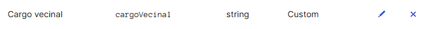
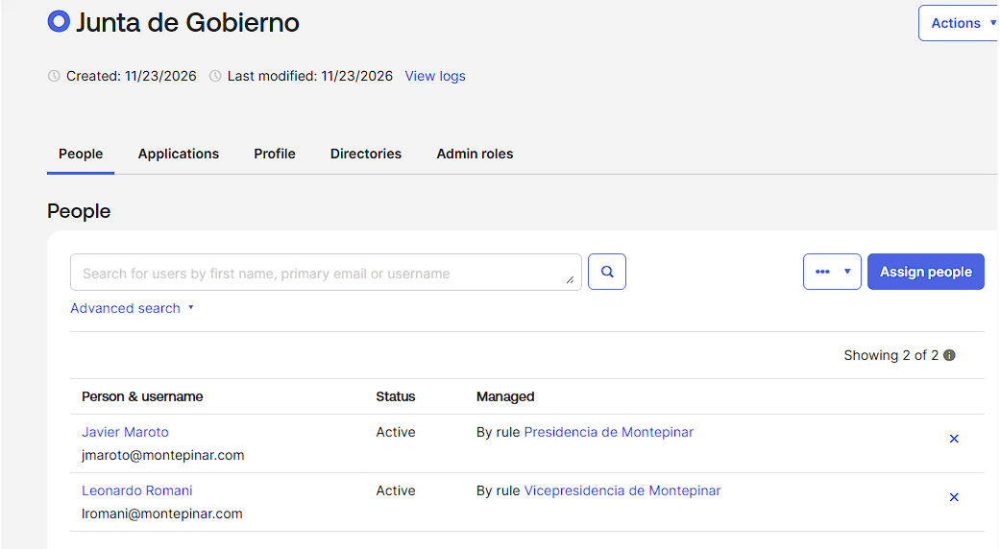
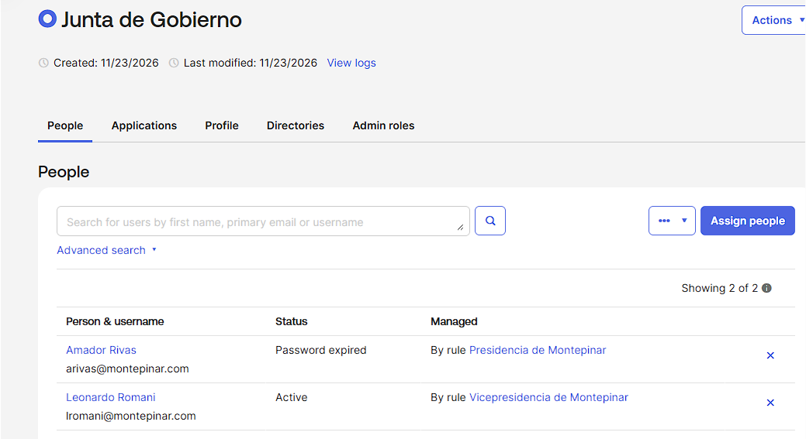
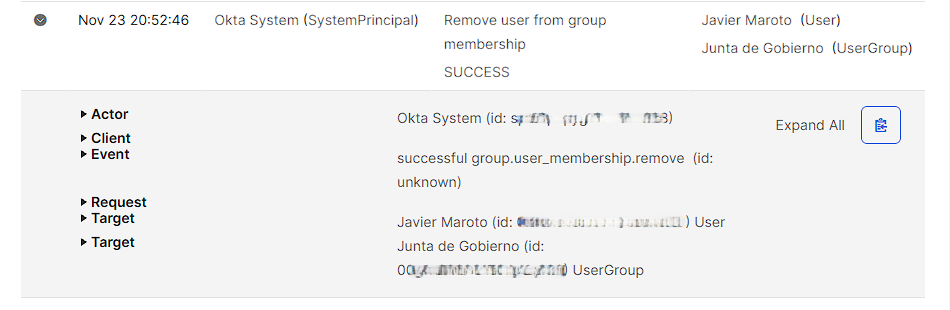

# Okta 01 — Un presidente, unos privilegios y un Cuqui descontrolado

## 1. Descripción del proyecto

Este laboratorio está inspirado en el primer episodio de la segunda temporada de *La que se avecina*: **«Un soltero, un yogur con fibra y un nuevo presidente»**.

Tras la salida de Javi Maroto de la presidencia de Mirador de Montepinar, Amador Rivas decide presentar su candidatura y termina convirtiéndose en el nuevo presidente de la comunidad. Maite Figueroa celebra entusiasmada su ascenso a primera dama, mientras Leo Romaní continúa desempeñando las funciones de vicepresidente.

Sin embargo, el cambio de presidencia trae consigo un problema que nadie había previsto: la gestión de los cargos y las responsabilidades de los vecinos sigue dependiendo de registros manuales que no siempre se actualizan correctamente.

Javi continúa figurando como presidente, Amador todavía aparece como un propietario más y algunos vecinos conservan pertenencias a grupos que ya no les corresponden. Ante semejante descontrol, Enrique Pastor propone modernizar la administración de Mirador de Montepinar S. L. mediante la implantación de **Okta Identity Cloud** como plataforma centralizada de gestión de identidades.

El objetivo de este laboratorio es configurar y validar un sistema de gestión de usuarios basado en **Okta Universal Directory**, utilizando atributos personalizados para representar los cargos de la comunidad y reglas dinámicas (*Group Rules*) para automatizar las pertenencias a grupos.

A través del relevo entre Javi y Amador, se comprobará cómo una modificación en los atributos de un usuario puede provocar una actualización automática de su pertenencia a los grupos correspondientes, sin necesidad de gestionar manualmente cada asignación.

También se analizará el comportamiento de las reglas ante cambios de cargo y excepciones, verificando los resultados mediante la consola de administración de Okta y los eventos registrados en **System Log**.

El laboratorio permitirá aplicar conceptos fundamentales de *Identity and Access Management (IAM)*, especialmente la administración centralizada de identidades, la gestión de atributos y la automatización de asignaciones basadas en información del perfil.

**Escenario ficticio:** Mirador de Montepinar S. L., donde Amador Rivas acaba de descubrir que convertirse en presidente es mucho más fácil que conseguir que los vecinos reconozcan sus nuevas responsabilidades. Y donde, gracias a Okta, al menos los grupos de usuarios estarán mejor organizados que las juntas de propietarios.

## 2. Objetivos técnicos

El propósito de este laboratorio es implementar un sistema de asignación automática de grupos en Okta a partir de los atributos de los usuarios, simulando un cambio de responsabilidades dentro de Mirador de Montepinar.

Para ello, se establecen los siguientes objetivos:

1. **Personalizar Universal Directory:** crear el atributo `cargoVecinal` para representar los cargos de los vecinos dentro de la comunidad.
2. **Automatizar la pertenencia a grupos:** configurar reglas dinámicas que incorporen a presidentes y vicepresidentes al grupo `Junta de Gobierno`.
3. **Gestionar cambios de responsabilidad:** simular el relevo de Javi Maroto por Amador Rivas sin modificar manualmente las pertenencias.
4. **Comprobar las limitaciones de las reglas:** observar qué ocurre cuando dos usuarios tienen simultáneamente el cargo de presidente.
5. **Auditar los cambios:** utilizar System Log para identificar y verificar los eventos de incorporación y eliminación de miembros.
6. **Evitar efectos sobre configuraciones existentes:** mantener separado el grupo `Junta de Gobierno` del grupo `Junta`, que ya dispone de una política de inscripción de autenticadores.

## 3. Entorno y tecnologías utilizadas

El laboratorio se ha desarrollado en un entorno **Okta Integrator Free Plan**, utilizando la consola de administración para gestionar las identidades de los vecinos de Mirador de Montepinar.

### Tecnologías y funcionalidades

| Tecnología | Aplicación en el laboratorio |
|---|---|
| Okta Identity Cloud | Plataforma de gestión de identidades. |
| Universal Directory | Administración de usuarios y atributos de perfil. |
| Custom Attributes | Creación del atributo `cargoVecinal`. |
| Okta Groups | Organización de los miembros de la Junta de Gobierno. |
| Group Rules | Asignación y retirada automática de usuarios según su cargo. |
| System Log | Auditoría de los cambios de pertenencia a grupos. |

### Identidades utilizadas

| Usuario | Cargo inicial | Cargo final |
|---|---|---|
| Javier Maroto | Presidente | ExPresidente |
| Amador Rivas | Propietario | Presidente |
| Leonardo Romaní | Vicepresidente | Vicepresidente |
| Enrique Pastor | Propietario | Propietario |

### Grupos y reglas

Se creó el grupo `Junta de Gobierno` para gestionar automáticamente la pertenencia de los vecinos que ocupan cargos de responsabilidad.

Se configuraron dos reglas:

- **Presidencia de Montepinar:** incorpora al grupo a los usuarios cuyo atributo `cargoVecinal` sea `Presidente`.
- **Vicepresidencia de Montepinar:** incorpora al grupo a los usuarios cuyo atributo `cargoVecinal` sea `Vicepresidente`.

El grupo `Junta`, existente de prácticas anteriores, se mantuvo sin modificaciones porque tenía asociada una política de inscripción de autenticadores que exigía Okta Verify y contraseña.

De esta forma, las pruebas de automatización se realizaron sin modificar los requisitos de autenticación del grupo original.


## 4. Desarrollo del laboratorio

### 4.1. Preparación de las identidades en Universal Directory

El primer paso consistió en preparar las identidades de los vecinos implicados en el cambio de presidencia.

Desde **Directory → People**, se crearon las cuentas de Javier Maroto y Leonardo Romaní. Las identidades de Amador Rivas y Enrique Pastor ya existían en el entorno y pudieron reutilizarse.

A continuación, desde **Directory → Profile Editor**, se añadió al perfil de usuario de Okta el siguiente atributo personalizado:

| Propiedad | Valor |
|---|---|
| Display Name | Cargo vecinal |
| Variable Name | `cargoVecinal` |
| Data Type | String |
| Attribute Type | Custom |

Este atributo permite representar las responsabilidades de cada vecino dentro de la comunidad, independientemente de su profesión o de otros datos personales.

**Evidencia 01 — Atributo personalizado `cargoVecinal`**



Una vez creado el atributo, se configuraron los perfiles con los cargos correspondientes al comienzo del episodio:

| Usuario | `cargoVecinal` |
|---|---|
| Javier Maroto | `Presidente` |
| Leonardo Romaní | `Vicepresidente` |
| Amador Rivas | `Propietario` |
| Enrique Pastor | `Propietario` |

Esta configuración representa la situación anterior al relevo de presidencia.

### 4.2. Creación del grupo Junta de Gobierno

Durante la preparación se identificó que el grupo `Junta`, utilizado en prácticas anteriores, tenía asociada una política de inscripción de autenticadores que exigía contraseña y Okta Verify.

Para evitar que las pruebas modificaran indirectamente los requisitos de autenticación de otros usuarios, se decidió conservar dicho grupo y crear uno independiente:

**Grupo:** `Junta de Gobierno`

**Descripción:** Órgano de gobierno de Mirador de Montepinar. La pertenencia se determina automáticamente según el cargo vecinal.

El nuevo grupo se creó inicialmente sin miembros asignados de forma manual.

### 4.3. Configuración de las Group Rules

Desde **Directory → Groups → Rules**, se crearon dos reglas para gestionar la pertenencia a `Junta de Gobierno` según el valor del atributo `cargoVecinal`.

**Regla 1: Presidencia de Montepinar**

| Parámetro | Configuración |
|---|---|
| Condición | `cargoVecinal` equals `Presidente` |
| Acción | Assign to `Junta de Gobierno` |
| Estado | Active |

**Regla 2: Vicepresidencia de Montepinar**

| Parámetro | Configuración |
|---|---|
| Condición | `cargoVecinal` equals `Vicepresidente` |
| Acción | Assign to `Junta de Gobierno` |
| Estado | Active |

Tras activar las reglas, Okta incorporó automáticamente a Javier Maroto y Leonardo Romaní al grupo.

Amador Rivas y Enrique Pastor permanecieron fuera porque sus atributos no cumplían ninguna de las condiciones establecidas.

**Evidencia 02 — Junta de Gobierno antes del relevo**



La captura muestra a Javier Maroto y Leonardo Romaní como miembros del grupo, con pertenencias gestionadas mediante reglas.

### 4.4. El ascenso de Amador Rivas

Llegó el momento de trasladar a Okta uno de los acontecimientos del capítulo: Amador Rivas se convierte en el nuevo presidente de Mirador de Montepinar.

Desde **Directory → People → Amador Rivas → Profile**, se modificó su atributo:

`cargoVecinal: Propietario → Presidente`

Después del cambio, Okta añadió automáticamente a Amador al grupo `Junta de Gobierno`.

Sin embargo, apareció una situación interesante: **Javi seguía figurando como presidente**, por lo que los dos cumplían la condición de la misma Group Rule.

El grupo pasó temporalmente a tener tres miembros:

- Javier Maroto — Presidente.
- Amador Rivas — Presidente.
- Leonardo Romaní — Vicepresidente.

Esta prueba permitió comprobar que las Group Rules evalúan los atributos de los usuarios, pero no garantizan que un cargo sea exclusivo.

### 4.5. Resolución del conflicto de presidencia

Para completar el relevo, se modificó el perfil de Javier Maroto:

`cargoVecinal: Presidente → ExPresidente`

Al dejar de cumplir la condición de la regla `Presidencia de Montepinar`, Javi fue retirado automáticamente del grupo.

La composición final de `Junta de Gobierno` quedó así:

| Usuario | Cargo final | Pertenece al grupo |
|---|---|---|
| Amador Rivas | Presidente | Sí |
| Leonardo Romaní | Vicepresidente | Sí |
| Javier Maroto | ExPresidente | No |
| Enrique Pastor | Propietario | No |

**Evidencia 03 — El relevo de presidencia**



La captura muestra la composición final de `Junta de Gobierno`, con Amador y Leo como únicos miembros.

El proceso confirmó que las reglas permiten incorporar y retirar usuarios automáticamente cuando cambia la información de sus perfiles.

### 4.6. Auditoría mediante System Log

Finalmente, se utilizó **Reports → System Log** para comprobar que los cambios de pertenencia habían quedado registrados.

Para localizar las incorporaciones, se aplicó el filtro:

```text
eventType eq "group.user_membership.add"
```

Se encontraron eventos con resultado `SUCCESS` correspondientes a las incorporaciones de Javier Maroto, Leonardo Romaní y Amador Rivas.

Posteriormente, se buscó la retirada de miembros mediante:

```text
eventType eq "group.user_membership.remove"
```

La búsqueda devolvió el evento correspondiente a la eliminación automática de Javier Maroto:

| Campo | Resultado |
|---|---|
| Fecha | 23/11/2026 |
| Hora | 20:52:46 |
| Actor | Okta System |
| Evento | Remove user from group membership |
| Usuario afectado | Javier Maroto |
| Grupo | Junta de Gobierno |
| Resultado | SUCCESS |

**Evidencia 04 — Auditoría de la salida automática**



De esta manera, el laboratorio permitió verificar tanto el resultado de las reglas en el directorio como su registro en los eventos de auditoría.


## 5. Pruebas y resultados

Una vez configuradas las dos Group Rules, se realizaron varias pruebas para comprobar cómo respondía Okta a los cambios de cargo de los vecinos de Mirador de Montepinar.

### 5.1. Pruebas funcionales

| Prueba | Acción realizada | Resultado observado | Estado |
|---|---|---|---|
| 01. Asignación automática del presidente | Activar la regla `Presidencia de Montepinar` con Javi como presidente. | Javi se incorporó automáticamente a `Junta de Gobierno`. | Correcto |
| 02. Asignación automática del vicepresidente | Activar la regla `Vicepresidencia de Montepinar`. | Leo se incorporó automáticamente al grupo. | Correcto |
| 03. Ascenso de Amador | Cambiar `cargoVecinal` de `Propietario` a `Presidente`. | Amador se incorporó al grupo sin asignación manual. | Correcto |
| 04. Presidencia duplicada | Mantener simultáneamente a Javi y Amador con el cargo `Presidente`. | Ambos permanecieron en el grupo porque cumplían la condición de la regla. | Comportamiento verificado |
| 05. Salida del presidente anterior | Cambiar el atributo de Javi a `ExPresidente`. | Okta retiró automáticamente a Javi del grupo. | Correcto |
| 06. Auditoría de pertenencias | Consultar los eventos de incorporación y eliminación en System Log. | Se localizaron eventos `SUCCESS` correspondientes a los cambios realizados. | Correcto |

Las pruebas confirmaron que la pertenencia a `Junta de Gobierno` dependía de los valores de `cargoVecinal`, sin necesidad de añadir o retirar manualmente a los personajes.

### 5.2. Limitación detectada: dos presidentes en Montepinar

Durante el ascenso de Amador Rivas se produjo una situación que, tratándose de Mirador de Montepinar, tampoco resulta especialmente sorprendente: **la comunidad terminó temporalmente con dos presidentes**.

Javi conservaba el valor `Presidente` en su perfil cuando Amador recibió el mismo cargo.

La regla incorporó a ambos porque los dos cumplían su condición.

Esto permitió identificar una limitación del diseño:

**Las Group Rules automatizan la pertenencia a grupos, pero no garantizan la exclusividad de los valores utilizados como criterio.**

En este laboratorio, Okta no rechazó la existencia de dos presidentes ni impidió que ambos pertenecieran a `Junta de Gobierno`.

Desde el punto de vista de IAM, esta situación puede convertirse en un problema si la pertenencia al grupo concede acceso a aplicaciones o recursos sensibles.

Para reducir ese riesgo en un entorno empresarial, sería necesario controlar quién puede modificar los atributos utilizados por las reglas y establecer un procedimiento de aprobación y validación de los cambios de responsabilidad.

Estas medidas se identifican como posibles mejoras; no se implementaron en el laboratorio.

### 5.3. Resultado final

Tras completar el relevo de presidencia, la composición del grupo quedó ajustada a los cargos establecidos:

| Usuario | Cargo final | Pertenencia a `Junta de Gobierno` |
|---|---|---|
| Amador Rivas | Presidente | Miembro |
| Leonardo Romaní | Vicepresidente | Miembro |
| Javier Maroto | ExPresidente | No miembro |
| Enrique Pastor | Propietario | No miembro |

Las dos reglas permanecieron activas al finalizar las pruebas.

La consulta de System Log permitió confirmar que la retirada de Javier Maroto quedó registrada el 23 de noviembre de 2026 a las 20:52:46, con resultado `SUCCESS` y `Okta System` como actor.

**Resultado del laboratorio:** se verificó la incorporación y retirada automática de usuarios mediante Group Rules basadas en atributos personalizados, así como la trazabilidad de los cambios de pertenencia mediante System Log.

El sistema funcionó conforme a las condiciones configuradas, aunque la prueba de presidencia duplicada evidenció la necesidad de controles adicionales sobre la modificación de atributos.
